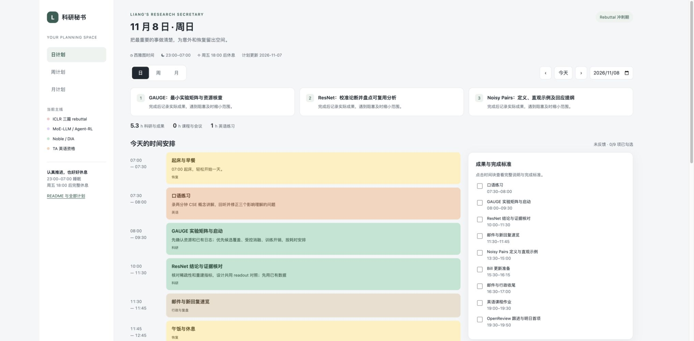

# Liang 的科研秘书计划中心

面向 UW CSE 博士的科研、TA 英语和日常事务。时间统一使用 **America/Los_Angeles（西雅图时间）**。目标是稳定交付关键成果，同时保留 **23:00–07:00 睡眠**与**周五 18:00 后完整休息**。

你会在睡前向秘书汇报实际进度。秘书会具体肯定真实成果，记录完成、推进和阻塞，调整下一天与本周剩余计划，并自行 commit、push。计划中的条目不等于已经完成。

## 直接打开计划

**在线网页：[打开 Liang 的科研计划中心](https://divinyan.com/planner/)**。日、周、月三个视图都在同一个网页里，无需下载，也无需登录。此目录随个人主页通过 GitHub Pages 公开发布。

本计划的唯一维护位置是 [`lylybig/lylybig.github.io` 仓库的 `planner/`](https://github.com/lylybig/lylybig.github.io/tree/main/planner)。原计划仓库保留迁移说明和历史版本，后续不再维护两份计划。

| 入口 | HTML |
| --- | --- |
| 日周月总入口 | [打开计划中心](index.html) |
| 今日 11 月 7 日剩余安排 | [今日详细日计划](daily/2026-11-07.html) |
| 明日 11 月 8 日 | [明日详细日计划](daily/2026-11-08.html) |
| 11 月 9–15 日 | [首轮回复周计划](weekly/2026-11-09.html) |
| 11 月 16–22 日 | [收敛与科研恢复周计划](weekly/2026-11-16.html) |
| 2026 年 11 月 | [完整月计划](monthly/2026-11.html) |
| 全部入口清单 | [计划文件索引](plan-manifest.json) |

HTML 使用轻色系，可切换日、周、月，点击时间块查看完整任务与完成标准，也能勾选成果、记录和导出晚间复盘。手机端周计划会改为逐日列表。

平时直接使用在线网页。GitHub 保存计划、原始数据和修改历史；下方相对链接用于查阅对应文件。每份 HTML 也内嵌样式、交互和整月数据，可作为单文件离线备份。本地预览命令为 `npm run preview`。



[周计划预览](assets/preview-week.jpg) · [月计划预览](assets/preview-month.jpg)

## Deadline 与轻重缓急

以下顺序体现当前紧急程度。**正式 deadline、内部目标、待确认日期分开记录。** 新的注册或课程硬截止会改变优先级。

| 顺序 | 事项 | Deadline 或检查点 | 性质与安排 |
| --- | --- | --- | --- |
| P0 1 | 三篇 ICLR 2027 作者讨论 | **2026-11-18 AoE** | [官方日期](https://iclr.cc/Conferences/2027/CallForPapers)。官网未列精确时分，仍需核对系统实际截止；讨论期间可修订论文。 |
| P0 2 | 三篇最终回复与必要修订 | **11-18 18:00 西雅图时间** | 内部执行截止，含逐篇保存与版本确认；16:30–18:00 留故障缓冲。 |
| P0 3 | 首轮完整回复 | GAUGE **11-10**；ResNet **11-11**；Noisy Pairs **11-12** | 内部目标。Noisy Pairs 的问题定义与范围澄清争取 11-09 提前回应；给后续讨论留时间。 |
| P0 4 | 主要内容收敛 | **11-16 20:00** | 内部检查点：回复、证据及必要论文修订达到可提交状态。 |
| P0 5 | 下季度 TA 英语资格 | **实际资格办理与成绩录入截止待确认** | 每天推进。Winter 2027 于 2027-01-04 开课，这不是已确认的资格办理截止。ENGL 105 B 或合格 DET 路线。 |
| P1 1 | UW 注册问题 | 真实截止未知；**11-09 前查清**为内部目标 | 若阻碍注册、学籍或 TA 聘任，立即上调到 P0。 |
| P1 2 | Kumar MoE-LLM 与 MoE-agent-RL 周进展 | **每周二约 13:00–14:00** | 两项目分别给结果、解释、阻塞与下一步；周一整理材料。 |
| P1 3 | Bill 一对一与 Noble 项目 | **周一 12:30–13:00** | 周日准备；DIA 到达日期未知。数据未到先保证训练、接入与评估流程可用。 |
| P1 4 | 两个 MoE 项目赶 ICML 2027 | **投稿 deadline 待官宣** | 不把往年日期当作正式截止；11 月先建立可复现结果与实验决策。 |
| P1 5 | 英语课作业与最终考核 | **具体日期待 Canvas / syllabus 核实** | 11-09 前核实为内部目标；不能把校历教学结束日当作课程考核截止。 |
| P2 | Jingyang、咖啡邀请、英语资料回复 | **11-09 前尽快清理** | 内部目标，放进行政窗口；本系统不自动向他人发消息。 |

11 月 1–6 日没有补造计划或完成记录。11 月 7 日从剩余时段开始，不要求把已过去的工作块补到夜里。

## 三篇 rebuttal 的处理重点

| 论文 | 已读 reviews | 当前主要工作 | 首轮完整回复内部目标 |
| --- | --- | --- | --- |
| [GAUGE](https://openreview.net/forum?id=htzKaJTTMj) | 3、2、2 | 候选覆盖与偏差、受控消融、计算成本、历史表示与理论假设。先盘点 checkpoint、轨迹和已有结果，再决定必要重跑。 | 11-10 |
| [Do ResNets Route](https://openreview.net/forum?id=QyyltF4pw5) | 1、2、2 | 校准稀疏路由论断，区分系数质量与重建保真，优先共同 readout、global core 控制与现有 mask 输出的分析。 | 11-11 |
| [Noisy Pairs](https://openreview.net/forum?id=mR68gGETr1) | 2、3、2、1 | 先说明问题、定义和直观例子；再回答 coherence、remasking 等边界以及有限维常数。 | 11-12 |

这些是根据审稿意见制定的任务，尚不代表原稿证明或实验结论已经由秘书独立核验。11-14 后新增实验应能在 11-16 前产出并直接回应核心质疑。

## 固定安排与英语资格

| 安排 | 时间 | 确认范围 |
| --- | --- | --- |
| Bill 一对一 | 周一 12:30–13:00 | 11-09 日历实例已核实；未来按周例预留。 |
| Kumar 周汇报 | 周二约 13:00–14:00 | 用户确认约一小时。 |
| ENGL 105 B | 周二、周四 08:30–10:20 | 用户及官方课表确认，SLN 14444。 |
| Noble Lab Meeting | 周四 12:00–14:00 | 11-12 日历实例已核实；未来按周例预留，地点与例外需复核。 |
| 睡眠 | 每天 23:00–07:00 | 受保护的作息。 |
| 完整休息晚上 | 周五 18:00 后 | 不排邮件、实验监控或课程作业。 |

[UW Policy 5.2](https://grad.uw.edu/policies/5-2-conditions-of-appointment-for-tas-who-are-not-native-speakers-of-english/)列出 DET **Conversation >=140** 为口语达标途径之一；ENGL 105 [最低通过成绩为 2.7](https://www.aep.uw.edu/courses/course-descriptions)。另需满足整体英语及适用培训要求。学校认定成绩并确认免修前，仍保留课程和作业。

[UW 校历](https://www.washington.edu/students/reg/2627cal.html)：11-26 Thanksgiving、11-27 Native American Heritage Day 不上课；本计划在 11-26 不排英语课和 Noble 组会，安排轻量维护与恢复。未来例外以真实通知为准。

## 本月阶段安排

| 阶段 | 主要交付 |
| --- | --- |
| 11-07 至 11-12 | 三篇问题清单、必要实验与首轮回复；MoE 保持周汇报；英语课程不断档。 |
| 11-13 至 11-18 | 跟进 reviewer、补证、核对数字及修订，16 日主要内容收敛，18 日内部截止前完成保存确认。 |
| 11-19 至 11-25 | 恢复 MoE 两项目和 Noble 推进，做一次 TA 口语诊断，明确 DET 与课程的实际路径。 |
| 11-26 至 11-30 | 感恩节轻量维护、汇总项目结果与阻塞、11-29 月度复盘，准备 12 月首周。 |

## 睡前汇报与次日调整

不用准备正式报告，直接在当前聊天告诉秘书：今天完成了什么、推进到哪、哪里卡住、精力和睡眠怎么样。秘书会：

1. 具体肯定真实成果；实验失败但排除假设、定位关键问题也记录为推进。
2. 把汇报存入 `data/reviews/YYYY-MM-DD.json`，更新实际进度。
3. 调整次日及本周剩余任务，必要时调整月度检查点；不把所有延期任务堆到明天。
4. 重建 HTML、更新 README、检查冲突与负荷，自行 commit 和 push 到个人主页仓库，触发 GitHub Pages 发布。
5. 核对本地与 GitHub 提交一致、在线网页包含新版本后，说明本次同步结果；任何一项失败都单独报告。

网页勾选和复盘会保存在当前浏览器，可导出 JSON。**浏览器里的本机状态不等于 GitHub 已更新**；以睡前聊天汇报或导出后的复盘入库为准。未知进度始终标记为未反馈。

## 定时任务与 GitHub 同步

**当前状态：定时任务尚未启用。** 系统拒绝了实际创建和待启用建议两种请求，原因是工具要求审批，但当前审批策略不允许弹出确认。已把三项任务的完整时间和可直接使用的说明保存在 [automation-status.json](automation-status.json)，需在应用中允许创建或由用户手动启用后才能定时运行。

待启用的任务方案如下：

| 任务 | 时间（西雅图） | 输出与同步 |
| --- | --- | --- |
| 日计划 | 每天 07:05 | 根据最新汇报更新当天计划、周计划受影响部分、README，校验后 commit 和 push。 |
| 周计划 | 每周日 16:00 | 生成下一周详细 HTML，更新本月阶段安排和入口，校验后 commit 和 push。 |
| 同步兜底 | 每天 07:15–23:15，每小时一次 | 检查本仓库内计划相关变更；无变化不空提交，有变化先校验再提交、推送并核对远端 SHA。 |

每次实际计划变更后由秘书在 `planner/` 运行 `npm run sync`，提交并推送到个人主页仓库，由 GitHub Pages 发布。GitHub 同步和网页上线分别核验；推送完成后发布可能需要几分钟。小时检查启用后用于兜底。同步命令只提交 `planner/` 内相关文件，校验后提交并推送，再比较远端 SHA；无变化不空提交。遇到认证、网络或冲突问题，保留本地成果并明确报告远端未更新；不强推覆盖用户变更。

自动任务涉及本机文件，需要 Mac 在线、桌面应用运行，且 SSH 与所需权限可用。[官方定时任务说明](https://developers.openai.com/training/walkthroughs/scheduled-tasks)

## 全部周计划

| 周起始日 | 本周重点 | HTML |
| --- | --- | --- |
| 2026-11-02 起 | 启动周末 | [周计划](weekly/2026-11-02.html) |
| 2026-11-09 起 | 三篇首轮回复 | [周计划](weekly/2026-11-09.html) |
| 2026-11-16 起 | Rebuttal 收敛与项目恢复 | [周计划](weekly/2026-11-16.html) |
| 2026-11-23 起 | MoE 与 DIA 稳定推进 | [周计划](weekly/2026-11-23.html) |
| 2026-11-30 起 | 月末交接 | [周计划](weekly/2026-11-30.html) |

11-02 周入口只覆盖 11-07 至 11-08；11-30 周入口当前只覆盖本月最后一天。未生成日期会明确显示暂无计划，不补造任务。

## 全部日计划

| 日期 | HTML |
| --- | --- |
| 2026-11-07 | [日计划](daily/2026-11-07.html) |
| 2026-11-08 | [日计划](daily/2026-11-08.html) |
| 2026-11-09 | [日计划](daily/2026-11-09.html) |
| 2026-11-10 | [日计划](daily/2026-11-10.html) |
| 2026-11-11 | [日计划](daily/2026-11-11.html) |
| 2026-11-12 | [日计划](daily/2026-11-12.html) |
| 2026-11-13 | [日计划](daily/2026-11-13.html) |
| 2026-11-14 | [日计划](daily/2026-11-14.html) |
| 2026-11-15 | [日计划](daily/2026-11-15.html) |
| 2026-11-16 | [日计划](daily/2026-11-16.html) |
| 2026-11-17 | [日计划](daily/2026-11-17.html) |
| 2026-11-18 | [日计划](daily/2026-11-18.html) |
| 2026-11-19 | [日计划](daily/2026-11-19.html) |
| 2026-11-20 | [日计划](daily/2026-11-20.html) |
| 2026-11-21 | [日计划](daily/2026-11-21.html) |
| 2026-11-22 | [日计划](daily/2026-11-22.html) |
| 2026-11-23 | [日计划](daily/2026-11-23.html) |
| 2026-11-24 | [日计划](daily/2026-11-24.html) |
| 2026-11-25 | [日计划](daily/2026-11-25.html) |
| 2026-11-26 | [日计划](daily/2026-11-26.html) |
| 2026-11-27 | [日计划](daily/2026-11-27.html) |
| 2026-11-28 | [日计划](daily/2026-11-28.html) |
| 2026-11-29 | [日计划](daily/2026-11-29.html) |
| 2026-11-30 | [日计划](daily/2026-11-30.html) |

## 维护与文件结构

```text
data/profile.json        作息、固定安排、项目与信息来源
data/YYYY-MM.json        月度阶段、周交付、日重点、具体时间块
data/progress.json       已确认的实际状态
data/reviews/            睡前汇报和调整依据
src/                     HTML 模板、轻色系样式与交互源代码
scripts/                 构建、检查和本地预览
daily/                   每日 HTML
weekly/                  每周 HTML
monthly/                 每月 HTML
assets/                  共用前端与计划数据
AGENTS.md                秘书的维护与同步规则
```

无需安装依赖，Node.js 20+ 即可：

```sh
npm run build
npm run check
npm run preview
```

详细背景参考：[原秘书档案](https://chatgpt.com/space/page_2739bab71520819187ee9b7611948929)。后续以本仓库最新计划和实际汇报为主要依据。

