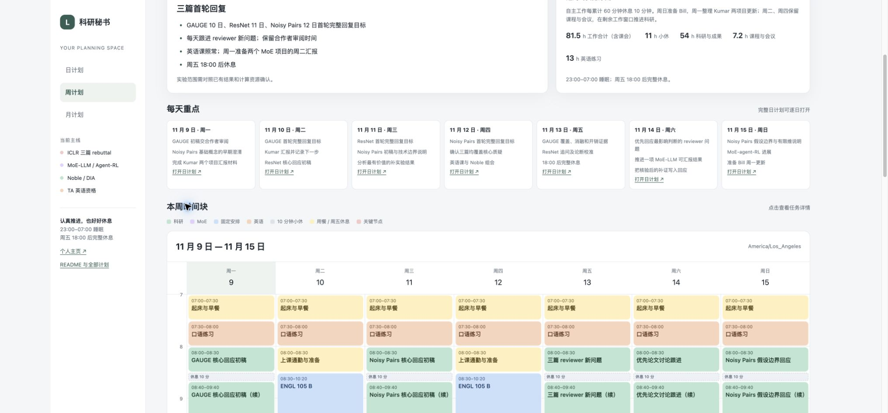

# Liang 的科研秘书计划中心

面向 UW CSE 博士的科研、TA 英语和日常事务。时间统一使用 **America/Los_Angeles（西雅图时间）**。目标是稳定交付关键成果，同时保留 **23:00–07:00 睡眠**与**周五 18:00 后完整休息**。

当前统一节奏是 **自主工作累计 60 分钟，休息 10 分钟**；相邻任务切换不重置计时。你会在睡前向秘书汇报实际进度。秘书会具体肯定真实成果，记录完成、推进和阻塞，调整下一天与本周剩余计划，并自行 commit、push。计划中的条目不等于已经完成。

## 直接打开计划

**在线网页：[打开 Liang 的科研计划中心](https://divinyan.com/planner/)**。日、周、月三个视图都在同一个网页里，无需下载，也无需登录。此目录随个人主页通过 GitHub Pages 公开发布。

本计划的唯一维护位置是 [`lylybig/lylybig.github.io` 仓库的 `planner/`](https://github.com/lylybig/lylybig.github.io/tree/main/planner)。原计划仓库保留迁移说明和历史版本，后续不再维护两份计划。

| 入口 | HTML |
| --- | --- |
| 日周月总入口 | [打开计划中心](https://divinyan.com/planner/index.html) |
| 今日 11 月 11 日 | [从真实起点重排的日计划](https://divinyan.com/planner/daily/2026-11-11.html) |
| 明日 11 月 12 日 | [Noisy Pairs 与 ResNet 合并核查](https://divinyan.com/planner/daily/2026-11-12.html) |
| 11 月 9–15 日 | [首轮回复周计划](https://divinyan.com/planner/weekly/2026-11-09.html) |
| 11 月 16–22 日 | [收敛与科研恢复周计划](https://divinyan.com/planner/weekly/2026-11-16.html) |
| 2026 年 11 月 | [完整月计划](https://divinyan.com/planner/monthly/2026-11.html) |
| 排程依据与口语路线 | [连续科研、估时与英语方案](https://divinyan.com/planner/method.html) |
| 全部入口清单 | [计划文件索引](plan-manifest.json) |

HTML 使用轻色系，可切换日、周、月，点击时间块查看完整任务与完成标准，也能勾选成果、记录和导出晚间复盘。手机端周计划会改为逐日列表。

平时直接使用在线网页。GitHub 保存计划、原始数据和修改历史；下方每份 HTML 链接都直接打开个人主页中的对应计划。每份 HTML 也内嵌样式、交互和整月数据，可作为单文件离线备份。本地预览命令为 `npm run preview`。

日、周、月网页均展示最新 60/10 时间块。**11-08 起新增连续主题、核心/延续区分和每天主动口语 75–90 分钟。** 今天已执行的计划和完成标记保留。下方截图是此前 60/10 版本，最新内容以网页为准。



[日计划预览](assets/cadence-day.jpg) · [月计划预览](assets/cadence-month.jpg)

## 全月统一的 60/10 工作政策

- 自主工作每累计 **60 分钟，休息 10 分钟**；多个短任务合计到 60 分钟也要休息。小休用于起身、喝水、走动，不处理工作消息。
- 除周五外，工作窗口为 **07:30–22:30**；取消原先 17:00–19:00 的大块恢复和 20:00 后自由时间，改为科研、英语和收尾工作。
- **07:00–07:30 早餐**；午饭、晚饭各 **30 分钟**。通常午饭 12:00–12:30、晚饭 18:00–18:30；周四有组会时午饭 11:30–12:00，周五晚饭 17:30–18:00。
- **22:00–22:10 邮件收尾；22:10–22:30 晚间汇报与明日安排，22:30–23:00 洗漱及睡前准备，23:00–07:00 睡眠。** 周五汇报移到 17:10–17:30，18:00 后完整休息。
- 固定课程、会议和通勤保留真实时间；课后、会后安排 10 分钟小休。不能自行把课程或组会拆开。
- 周末、学校假期也执行这条政策；假期只移除学校课程和组会。剩余容量用于同一问题深入，不逐日塞满全部项目。
- 完整非周五工作日约 **11 小时 50 分至 12 小时 20 分工作**，已包含课程、会议、英语与行政；周五约 **8 小时 20 分**。这是可用时间预算，包含同题延续，不等于同量的必须成果。核心安排与延续容量已在日周月网页分开显示；真实成果与阻塞按汇报记录。

## 连续科研、完成尺度与英语口语

本次排程从 **11-08** 生效，保留 11-07 的原计划、已勾选事件与真实状态。通常每天集中两个科研主题，上午同一问题连续 2–3 个 60/10 周期，休息后继续原问题；周一准备两个 MoE 项目汇报是多主题例外。课会多的日期减少新增科研成果。

- **核心块**承诺一项可控的最小产物，例如一条证据记录、一项配置、一段回应；每块标明主动分钟和依赖。科研估时是初估，尚未获得材料时不保证科学结果。
- **同题延续块**仍用于工作，吸收返工、机器等待与估时误差，不新增必须交付。延续未完成不降低核心进度，实际完成仍计 XP；XP 不代表科研质量。
- 切换前最后 2–3 分钟写下当前文件/命令、卡点、回来第一步。晚上比较预计与实际用时，缩小范围或移动低优先事项，不把延期全堆到第二天。
- 用户确认**持续可用 20 张 H100**；显存版本、互联、实测吞吐和排队尚未知。用户尚未整理三篇补实验，GAUGE 最重只是初步判断。**11-08 未开展工作；11-09 下午做三篇证据矩阵、GAUGE 最小配置，条件满足后试跑，测 ETA / GPU-hours 再分卡**。机器可并行，人的分析按连续主题排。
- **主动口语每天 75–90 分钟**：普通日 07:30–08:30 中开口 50 分钟，18:30–19:30 中开口 40 分钟；有课周二/周四早上 25、晚上 50 分钟。周五第二段移到 **16:00–17:00**，18:00 后不补做。听课、纯听材料和书面作业另计。
- 每天初录 → 找 3 个影响理解的问题 → 修改复录 → 模拟 TA 答问；每周日做一次 **5 分钟同题 mini lesson + 2 个追问**，比较结构、停顿与可理解性。实际练习分钟如实记录，不自动把计划算成完成。

75–90 分钟和连续 2–3 段是按当前目标设定的试行预算，不是研究证明的个人最优值。一周后依据录音、实际耗时、精力和课程反馈校准。口语在每日最多三项主要交付中占一项。

[排程依据与完整方案](https://divinyan.com/planner/method.html)区分了 Graham、Karpathy、Hamming、Pausch 的个人经验和注意残留实验研究，也记录了[指定知乎问题](https://www.zhihu.com/question/274835426)中本次实际读到的 8 条回答与取舍，不以成功者轶事保证结果。

## 历史单次安排（2026-11-07，仅当日）

- **23:00–23:15**：与 Siying 讨论 ResNet-MoE 论文的 rebuttal，记录关键质疑、证据、分工与下一步。
- 用户确认仅今晚例外，今晚 **23:15** 入睡，其他日期继续 **23:00–07:00** 作息；不设为周例会，也不自动标记已完成。
- [今天的日计划](https://divinyan.com/planner/daily/2026-11-07.html)。

## 11 月 11 日：从真实起点继续，今晚准点收工

用户约 **11:46** 表示刚开始工作，并明确要求给 **ResNet-MoE、MoE-LLM** 留时间。**12:14 后续调整：到 14:00 前集中准备 MS 讨论，口语移到会后，替换 GAUGE 延续。** 今天原上午计划保存在 `data/reviews/history/2026-11-11-plan-before-nov11-restart.json`；未当作已完成，也不推断用户几点起床。昨日两个 Kumar 项目工作块、MS 状态盘点已勾选；具体结果和真实耗时未知。

| 时间（西雅图） | 安排 | 可完成的尺度 |
| --- | --- | --- |
| 11:50–12:00 | 启动与定位材料 | 打开已有 MS 状态表和论文分工，核实 14:00 讨论加入方式。 |
| 12:00–12:30 | 午饭 | 完整 30 分钟。 |
| **12:30–13:30；13:40–14:00** | **会前只聚焦 MS-enhancement** | 接续同一份状态表，核对关键日志、讨论问题和入会方式；13:30–13:40 小休。 |
| **14:00–14:30** | **ms-res-enhance** | 昨日 Google Calendar 已核实的真实实例，地点/入口未填，提前核实；今天未重新声称同步日历。 |
| 14:40–15:40 | GAUGE 核心回应 | 最小交付仍是一组关键回应，标清已证与缺口；原延续小时用于口语，不保证全部 reviewer 定稿。 |
| **15:50–16:50** | **会后口语主练** | 主动开口 40 分钟 + 20 分钟纠错/必要课程作业；不把会议听讲计入。 |
| **17:00–18:00** | **MoE-LLM** | 接着昨日同一问题，完成一项分析、诊断或可运行配置；不要求全套实验返回。 |
| 18:00–18:30 | 晚饭 | 完整 30 分钟。 |
| **18:30–19:30；19:40–20:40** | **ResNet-MoE，两位 reviewer** | 每段先完成一位最关键解释、证据出处与论断边界；中间休息 10 分钟。 |
| 20:50–21:50 | 同题口语复练 | 主动开口 50 分钟 + 10 分钟反馈/最急作业，今天口语计划共 **90 分钟**。 |
| 22:00–22:30 | 邮件与晚间汇报 | 22:10 起汇报实际成果、阻塞、口语分钟与明日第一步。 |
| **22:30–23:00** | **洗漱、准备入睡** | 22:30 停止工作，23:00 睡；明日起恢复 07:00 起床目标。实际睡眠另记。 |

其他工作间隔均为 10 分钟小休，换项目不重置计时。今天保留三个科研主题是用户明确要求的单日例外，顺序执行，核心最小产物达成后才深入；缺材料时记录阻塞，不同时打开所有项目。

**范围调整：** 会前增加 45 分钟同题准备，GAUGE 的一小时延续改为口语，其他科研块保留，全天主动口语仍 90 分钟。GAUGE 核心回应今天做，可读首稿目标改到 **11-13 上午原有 GAUGE 时段**；ResNet 用户两份解释稿今天做，与 Siying 合并核查改到 **11-12 20:50–21:50**，替换原 Noisy Pairs 的一个延续块。Noisy Pairs 仍保留 11-12 的 3 个核心小时和 2 个延续小时，首稿缺口在 11-13 原时段处理。正式 **11-18 AoE**、**11-16 20:00 主要内容收敛**及 **11-18 18:00 内部截止**不变，没有把延期全部堆到明天。

今天已经开始，就从这一块往前走。晚开始的时间如实记录，完成的进展也如实收好；今晚按时结束，是恢复作息的第一步。

## 11 月 10 日历史安排：会议、Kumar、MS-enhancement 与口语

已读取本地完成标记：11-09 的 GAUGE 配置/延续、两份 MoE 更新和英语工作块已勾选；11-10 的口语热身、ENGL 105 B 已勾选。保留全部原始 ID 和时间。勾选只表示该工作块由本人标记完成，具体科研结论、主动口语实际分钟、睡眠与精力仍待汇报。

| 时间（西雅图） | 今日安排 | 最小完成标准 |
| --- | --- | --- |
| 原 10:30–11:30 预算 | 转入 Kumar / MoE-agent-RL | 今天 GAUGE 不做；仅调整未完成计划的归属，实际分钟和成果待汇报。 |
| **11:30–12:00** | **提前午饭** | 完整 30 分钟用餐。 |
| **12:00–13:00** | **Computational Proteomics Journal Club** | Google Calendar 已核实，**GNOM-S448**。13:00 结束后休息 10 分钟；日历也提供线上入口。 |
| **13:00–14:00 原会议取消** | **仅今天取消 Kumar 汇报** | 用户明确要求；未来周例保留。腾出时间给现有项目，不假设已收到今日会议反馈。 |
| 13:10–14:10；14:20–15:20 | MoE-LLM，连续两个工作小时 | 核心选定一个现有关键问题并产出配置/诊断；第二段同题延续，不新增硬交付。 |
| 15:30–16:30 | MoE-agent-RL | 沿已有材料，明确一个环境/奖励/评估验收点，形成配置或日志诊断。 |
| 16:40–17:40；18:10–19:10；19:20–20:20 | MS-enhancement，合计 3 小时 | 核心是一页真实状态表与最小验证路径；后两段为同题延续。DIA 未到就验证接入/训练/评估流程，不保证模型训完。 |
| 17:40–18:10 | 晚饭 | 完整 30 分钟，饭后接续同一个 MS 流程。 |
| 20:30–21:30；21:40–22:10 | 英语口语与必要作业 | 晚间主动开口 50 + 15 分钟，连同上午计划 25，共 **90 分钟**；听课不计入口语，实际分钟另记。 |
| 22:10–22:30 | 必要邮件与晚间汇报 | 记录真实反馈、阻塞与实际用时。22:30 睡前准备，23:00 睡。 |

工作段之间按 60/10 小休；午饭、晚饭各 30 分钟。今天只有中午 Journal Club，Kumar 汇报已取消，会后 13:00–13:10 小休。今天全天工作容量含课程会议为 12 小时 10 分钟，其中同题延续 3 小时；这不是同量的新增成果承诺。今天 GAUGE 待办已取消，原 60 分钟预算全部转入 Kumar；原时段实际执行未知。三个科研主题是**仅今天的明确例外**，下午按两个 MoE → 同一个 MS 流程顺序推进，不反复切回三篇论文。

**明天周三 11-11 14:00–14:30：ms-res-enhance**，已在 Google Calendar 核实，地点和视频入口未填写，12:30 起用同一份材料准备并提前核实加入方式。虽然是 UW 假日，这个明确存在且用户确认参加的实例仍保留；未看到重复规则，不推断以后每周都有。

**有取舍的延期：GAUGE 可读首稿内部目标由 11-10 改至 11-11；ResNet 11-11 上午保留；Noisy Pairs 定义、例子与首稿集中在 11-12。** 周四安排 3 个核心小时与同题延续，估时仍有不确定性；先交已证内容与缺口，11-13 原有 Noisy Pairs 时段继续补强。11-16 主要内容收敛、11-18 18:00 内部执行截止与官方 11-18 AoE 不变。本周和月度节点已同步改动，没有把延期全部堆到今晚。

## 11 月 9 日历史记录：重新起步与当日调整

用户 11-09 上午汇报：**11-08 休息一天，未开展工作**，约 10:49 到办公室。昨日原计划保留为当时计划，实际记录为未开展工作；今天从 **11:00** 的剩余时段开始，不将所有延期项追加到夜里。今日原版已归档到 data/reviews/history/，未收到确认的上午工作不算完成。

下午更新：你已勾选 Bill 会面准备、会面及截止核实三个工作块，完成记录与时间均保留；只调整未完成安排。外卖预计 **13:36** 到，午饭改为 **13:50–14:20**。总体顺延半小时，遇午饭的首项前后衔接；为 **23:00 收工**，仅将 GAUGE 可选试跑延续从 60 分钟缩至 30 分钟，核心任务与主动口语 75 分钟保留。

| 时间（西雅图） | 今天做什么 | 可完成的尺度 |
| --- | --- | --- |
| 11:00–11:30；11:30–12:00 | Bill 准备；截止与必要邮件 | 已勾选完成，保留原记录。 |
| 12:30–13:00 | Bill 一对一 | 已勾选完成，保留会议时间。 |
| 13:40–13:50 | 三篇分级材料准备 | 打开 reviews 和证据位置，饭后继续同一项，不新增交付。 |
| **13:50–14:20** | **午饭** | 完整 30 分钟用餐。13:36 为外卖预计送达时间。 |
| 14:20–15:10 | 三篇问题分级 → GAUGE 优先项 | 与饭前 10 分钟合计原任务的 60 分钟，产出一页分级表。 |
| 15:20–16:20 | GAUGE 最小受控配置 | 一项配置/命令或确切阻塞；不要求训练跑完。 |
| 16:30–17:00 | GAUGE 可选试跑延续 | 条件就绪才启动并记 ETA；未就绪就继续同题。 |
| 17:10–18:30 | 口语主练与反馈 | 主动口语 45 分钟；18:10–18:20 小休，再收好反馈。 |
| 18:30–19:00 | 晚饭 | 正常用餐。 |
| 19:00–20:00；20:10–21:10 | MoE-LLM；MoE-agent-RL 更新 | 各一页明日 Kumar 汇报材料，保留真实结果和阻塞。 |
| 21:20–22:20 | 口语复练与 ENGL 作业 | 主动口语 30 分钟 + 反馈/作业，全天主动口语计划共 75 分钟。 |
| 22:30–23:00 | 邮件、reviewer 新问题与晚间汇报 | 23:00 结束工作。 |
| 23:00–23:30 | 洗漱及睡前准备 | 按今天工作结束时间保留原有 30 分钟，暂排 23:30 入睡；其他日期作息不变。 |

未列出的工作段间隙均为 10 分钟小休。12:00–12:30 的原午饭槽只保留为改期说明，不计为已用餐或新增工作成果。原版保存在 data/reviews/history/2026-11-09-plan-before-lunch-delay.json。

**ResNet-MoE 已减量**：用户负责两位 reviewer，Siying 负责一位，以解释为主；具体 reviewer ID 未指定，不猜分配。11-11 上午先留 **2 小时写回应 + 1 小时同题合并核查**；原 13/14 日大块 ResNet 时间改给 Noisy Pairs / GAUGE。这是一轮估时，不把回应稿或 Siying 的稿件当成已完成。

当时内部目标为 **GAUGE 11-10、ResNet 11-11、Noisy Pairs 11-12**；已由上方 11-10 新安排取代，GAUGE 改为 11-11，Noisy Pairs 集中到 11-12。若实验未返回，先呈现已验证证据和诚实边界。正式 ICLR 作者讨论结束日期已于 11-09 再核对官网，仍为 **11-18 AoE**；16 日主要内容收敛、18 日 18:00 内部执行截止保留。

## Deadline 与轻重缓急

以下顺序体现当前紧急程度。**正式 deadline、内部目标、待确认日期分开记录。** 新的注册或课程硬截止会改变优先级。

| 顺序 | 事项 | Deadline 或检查点 | 性质与安排 |
| --- | --- | --- | --- |
| P0 1 | 三篇 ICLR 2027 作者讨论 | **2026-11-18 AoE** | [官方日期](https://iclr.cc/Conferences/2027/CallForPapers)。官网未列精确时分，仍需核对系统实际截止；讨论期间可修订论文。 |
| P0 2 | 三篇最终回复与必要修订 | **11-18 18:00 西雅图时间** | 内部执行截止，含逐篇保存与版本确认；16:30–18:00 留故障缓冲。 |
| P0 3 | 首轮完整回复 | GAUGE **11-13**（11-11 核心回应）；ResNet **11-12**（11-11 用户两份）；Noisy Pairs **11-12** | 均为内部目标。Noisy Pairs 11-12 保留 5 小时科研；ResNet 合并核查替换该晚一小时延续，GAUGE 用 11-13 既有上午块；缺证据先给诚实边界。 |
| P0 4 | 主要内容收敛 | **11-16 20:00** | 内部检查点：回复、证据及必要论文修订达到可提交状态。 |
| P0 5 | 下季度 TA 英语资格与每日主动口语 | **实际资格办理与成绩录入截止待确认** | 每天主动口语 75–90 分钟，课程作业另计。Winter 2027 于 2027-01-04 开课，这不是已确认的资格办理截止。ENGL 105 B 或合格 DET 路线。 |
| P1 1 | UW 注册问题 | 真实截止未知；11-09 核实工作块已勾选，具体结论待记录 | 若阻碍注册、学籍或 TA 聘任，立即上调到 P0。 |
| P1 2 | Kumar MoE-LLM 与 MoE-agent-RL 周进展 | **每周二约 13:00–14:00** | 11-10 实例按用户要求取消；今日两项目计划预算为 120 / 120 分钟（含原 GAUGE 预算，实际分钟待汇报），未来周例继续预留。 |
| P1 3 | Bill 一对一与 Noble 项目 | **周一 12:30–13:00** | 周日准备；DIA 到达日期未知。数据未到先保证训练、接入与评估流程可用。 |
| P1 4 | 两个 MoE 项目赶 ICML 2027 | **投稿 deadline 待官宣** | 不把往年日期当作正式截止；11 月先建立可复现结果与实验决策。 |
| P1 5 | 英语课作业与最终考核 | **具体日期待 Canvas / syllabus 核实** | 11-09 前核实为内部目标；不能把校历教学结束日当作课程考核截止。 |
| P2 | Jingyang、咖啡邀请、英语资料回复 | **11-10 批处理** | 11-09 先识别真正紧急事项，其余移到明天；这是内部目标。本系统不自动代发。 |

11 月 1–6 日没有补造计划或完成记录。11 月 7 日从剩余时段开始，不要求把已过去的工作块补到夜里。

## 三篇 rebuttal 的处理重点

| 论文 | 已读 reviews | 当前主要工作 | 首轮完整回复内部目标 |
| --- | --- | --- | --- |
| [GAUGE](https://openreview.net/forum?id=htzKaJTTMj) | 3、2、2 | 候选覆盖与偏差、受控消融、计算成本、历史表示与理论假设。先盘点 checkpoint、轨迹和已有结果，再决定必要重跑。 | 11-13 可读首稿；11-11 核心回应 |
| [Do ResNets Route](https://openreview.net/forum?id=QyyltF4pw5) | 1、2、2 | 用户两位 reviewer、Siying 一位；以解释、主张边界与证据出处为主，先写回应，必要时复用已有输出，不预排大规模重训。 | 11-11 用户两份；11-12 合并核查 |
| [Noisy Pairs](https://openreview.net/forum?id=mR68gGETr1) | 2、3、2、1 | 先说明问题、定义和直观例子；再回答 coherence、remasking 等边界以及有限维常数。 | 11-12 |

先用一页矩阵确认已有证据与必要动作，GAUGE 的计算规模须经试跑。首轮目标按现有证据给完整诚实回应，不要求等待全部训练返回。

这些是根据审稿意见制定的任务，尚不代表原稿证明或实验结论已经由秘书独立核验。11-14 后新增实验须有测得的 ETA、负责人，并能在 11-16 前产出并直接回应核心质疑。

## 固定安排与英语资格

| 安排 | 时间 | 确认范围 |
| --- | --- | --- |
| Journal Club（今日参加） | 11-10 12:00–13:00 | 日历已核实，GNOM-S448；看见周二重复规则，暂仅纳入本次。 |
| MS-enhancement 讨论 | 11-11 14:00–14:30 | 日历已核实，地点/入口未填；未确认重复规则，假日实例保留。 |
| Bill 一对一 | 周一 12:30–13:00 | 11-09 日历实例已核实；未来按周例预留。 |
| Kumar 周汇报 | 周二约 13:00–14:00 | 11-10 今日实例按用户要求取消；后续周例继续预留。 |
| ENGL 105 B | 周二、周四 08:30–10:20 | 用户及官方课表确认，SLN 14444。 |
| Noble Lab Meeting | 周四 12:00–14:00 | 11-12 日历实例已核实；未来按周例预留，地点与例外需复核。 |
| 睡眠 | 每天 23:00–07:00 | 受保护的作息。 |
| 完整休息晚上 | 周五 18:00 后 | 不排邮件、实验监控或课程作业。 |

[UW Policy 5.2](https://grad.uw.edu/policies/5-2-conditions-of-appointment-for-tas-who-are-not-native-speakers-of-english/)列出 DET **Conversation >=140** 为口语达标途径之一；ENGL 105 [最低通过成绩为 2.7](https://www.aep.uw.edu/courses/course-descriptions)。另需满足整体英语及适用培训要求。学校认定成绩并确认免修前，仍保留课程和作业。

[UW 校历](https://www.washington.edu/students/reg/2627cal.html)：11-11 为 Veterans Day，仍保留已核实的 MS 讨论；11-26 Thanksgiving、11-27 Native American Heritage Day 不上课；本计划在 11-26 不排英语课和 Noble 组会，个人科研仍按 60/10 推进。未来例外以真实通知为准。

## 本月阶段安排

| 阶段 | 主要交付 |
| --- | --- |
| 11-07 至 11-12 | 11-11 从约中午恢复：MS 讨论、GAUGE 核心回应、MoE-LLM 一项推进、用户两份 ResNet 稿；11-12 Noisy Pairs 首稿与 ResNet 合并核查。 |
| 11-13 至 11-18 | 13 日上午用原有 GAUGE 时段收拢可读首稿，再跟进 reviewer 和补证；16 日主要内容收敛，18 日内部截止前完成保存确认。 |
| 11-19 至 11-25 | 恢复 MoE 两项目和 Noble 推进，做一次 TA 口语诊断，明确 DET 与课程的实际路径。 |
| 11-26 至 11-30 | 学校假期继续按 60/10 推进科研、汇总项目结果与阻塞、11-29 月度复盘，准备 12 月首周。 |

## 本地反馈与次日调整

“成果与完成标准”中加入 **科研小旅程**：勾选后在当前位置显示与任务相关的鼓励，小树、等级、进度条和成就随当天真实完成标记变化。核心进度只统计核心块，同题延续未完成不扣核心进度；XP 按已完成工作块的计划分钟计算；取消勾选会回退，反复勾选不叠加。休息和用餐不计分，没有连续打卡惩罚，也不代表科研质量。可关闭动效，并尊重系统的减少动态效果设置。刷新只恢复已有进度，不自动播放完成庆祝。保存成功、浏览器草稿与文件保存失败会分别显示。

**在这台 Mac 打开 [本地反馈页](http://127.0.0.1:4173/)**。勾选任务、填写复盘会通过本地保存接口直接写入 `data/progress.json`，不需要导出 JSON。服务运行时有效；仅更换成普通本地网页地址不会自动获得文件保存能力。

1. 勾选和输入：立即保存到本机计划文件，页面显示保存时间；刷新后从文件恢复。
2. 点击“保存复盘并同步 GitHub”：生成 `data/reviews/YYYY-MM-DD.json`，保存原始文字、已勾选任务与精力，提交、推送并核验网页。再次提交保留旧版本到 `data/reviews/history/`。
3. 对秘书说“按最新记录调整”：秘书直接读取文件，调整下一天和本周计划；不用复制记录或发送导出文件。保存不会自动唤醒秘书，后台定时任务仍未启用。

服务只监听本机 127.0.0.1。双击 `start-planner.command` 会检查服务、必要时启动独立后台进程，再打开网页；启动窗口可关闭。也可在 `planner/` 运行 `npm run start:background`，然后打开本地网址。重复启动会复用现有服务。`npm start` 仍是前台调试方式，停止它会停止对应服务。

如果看到 `ERR_CONNECTION_REFUSED`，表示本地服务没有接受连接。**这台 Mac 已安装本地网页常驻服务**：不依赖聊天和终端窗口，退出后由 macOS 自动重启，登录后自动启动。本次已实测退出恢复和反馈记录保留；登录自启按已加载的系统配置执行，未通过重启电脑测试。电脑关机期间本地网址不可访问。

可用 `npm run service:status` 查看状态；其他 Mac 在仓库中执行 `npm run service:install` 安装，`npm run service:uninstall` 停用。`start-planner.command` 仍可作为打开网页或手动恢复的入口。常驻服务日志及生成的运行代码位于 `~/Library/Application Support/DivinYanPlanner/`；源代码唯一维护在本仓库，计划与反馈仍直接读写这里的 `data/`，不维护第二份数据。普通后台启动日志位于忽略提交的 `work/local-server.log`。

这项常驻服务只维持本地网页和反馈接口，**日周计划与 Git 定时任务仍未启用**。更新 `scripts/serve.mjs` 或 `scripts/local-store.mjs` 后重新执行 `npm run service:install` 以刷新运行副本；仅修改 HTML 或计划数据无需重启。

**公开主页的交互仍是浏览器草稿**，页面提供本地反馈入口。当地页面显示“已写入文件”才代表落盘，GitHub 同步状态单独显示；同步失败不丢失本地记录。点击同步会把记录提交到公开个人主页仓库。

也可以继续在聊天里自然语言汇报。秘书处理实际记录时会：

1. 具体肯定真实成果；实验失败但排除假设、定位关键问题也记录为推进。
2. 把汇报存入 `data/reviews/YYYY-MM-DD.json`，更新实际进度。
3. 调整次日及本周剩余任务，必要时调整月度检查点；不把所有延期任务堆到明天。
4. 重建 HTML、更新 README、检查冲突与负荷，自行 commit 和 push 到个人主页仓库，触发 GitHub Pages 发布。
5. 核对本地与 GitHub 提交一致、在线网页包含新版本后，说明本次同步结果；任何一项失败都单独报告。

本地反馈文件与聊天汇报都是实际进度来源。完成只依据明确勾选或用户表述；未勾选代表未标记完成，不自动推断为完全没有推进。自由文字尚未由秘书分析时保留原文，inProgress、blockers、sleep、nextActions 等字段保持未知。

## 定时任务与 GitHub 同步

**当前状态：定时任务尚未启用。** 系统拒绝了实际创建和待启用建议两种请求，原因是工具要求审批，但当前审批策略不允许弹出确认。已把三项任务的完整时间和可直接使用的说明保存在 [automation-status.json](automation-status.json)，需在应用中允许创建或由用户手动启用后才能定时运行。

待启用的任务方案如下：

| 任务 | 时间（西雅图） | 输出与同步 |
| --- | --- | --- |
| 日计划 | 每天 07:05 | 根据最新汇报更新当天计划、周计划受影响部分、README，校验后 commit 和 push。 |
| 周计划 | 每周日 16:00 | 生成下一周详细 HTML，更新本月阶段安排和入口，校验后 commit 和 push。 |
| 同步兜底 | 每天 07:15–23:15，每小时一次 | 检查本仓库内计划相关变更；无变化不空提交，有变化先校验再提交、推送并核对远端 SHA。 |

每次实际计划变更后由秘书在 `planner/` 运行 `npm run sync`，提交并推送到个人主页仓库，由 GitHub Pages 发布。同步脚本会核对远端 SHA，并等待、比较线上日周月页面与本地内容；发布可能需要几分钟，等待超时会单独报告。也可用 `npm run verify:live` 再次核验。小时检查启用后用于兜底。同步命令只提交 `planner/` 内相关文件；无变化不空提交。遇到认证、网络或冲突问题，保留本地成果并明确报告远端未更新；不强推覆盖用户变更。

自动任务涉及本机文件，需要 Mac 在线、桌面应用运行，且 SSH 与所需权限可用。[官方定时任务说明](https://developers.openai.com/training/walkthroughs/scheduled-tasks)

## 全部周计划

| 周起始日 | 本周重点 | HTML |
| --- | --- | --- |
| 2026-11-02 起 | 启动周末 | [周计划](https://divinyan.com/planner/weekly/2026-11-02.html) |
| 2026-11-09 起 | 三篇首轮回复 | [周计划](https://divinyan.com/planner/weekly/2026-11-09.html) |
| 2026-11-16 起 | Rebuttal 收敛与项目恢复 | [周计划](https://divinyan.com/planner/weekly/2026-11-16.html) |
| 2026-11-23 起 | MoE 与 DIA 稳定推进 | [周计划](https://divinyan.com/planner/weekly/2026-11-23.html) |
| 2026-11-30 起 | 月末交接 | [周计划](https://divinyan.com/planner/weekly/2026-11-30.html) |

11-02 周入口只覆盖 11-07 至 11-08；11-30 周入口当前只覆盖本月最后一天。未生成日期会明确显示暂无计划，不补造任务。

## 全部日计划

| 日期 | HTML |
| --- | --- |
| 2026-11-07 | [日计划](https://divinyan.com/planner/daily/2026-11-07.html) |
| 2026-11-08 | [日计划](https://divinyan.com/planner/daily/2026-11-08.html) |
| 2026-11-09 | [日计划](https://divinyan.com/planner/daily/2026-11-09.html) |
| 2026-11-10 | [日计划](https://divinyan.com/planner/daily/2026-11-10.html) |
| 2026-11-11 | [日计划](https://divinyan.com/planner/daily/2026-11-11.html) |
| 2026-11-12 | [日计划](https://divinyan.com/planner/daily/2026-11-12.html) |
| 2026-11-13 | [日计划](https://divinyan.com/planner/daily/2026-11-13.html) |
| 2026-11-14 | [日计划](https://divinyan.com/planner/daily/2026-11-14.html) |
| 2026-11-15 | [日计划](https://divinyan.com/planner/daily/2026-11-15.html) |
| 2026-11-16 | [日计划](https://divinyan.com/planner/daily/2026-11-16.html) |
| 2026-11-17 | [日计划](https://divinyan.com/planner/daily/2026-11-17.html) |
| 2026-11-18 | [日计划](https://divinyan.com/planner/daily/2026-11-18.html) |
| 2026-11-19 | [日计划](https://divinyan.com/planner/daily/2026-11-19.html) |
| 2026-11-20 | [日计划](https://divinyan.com/planner/daily/2026-11-20.html) |
| 2026-11-21 | [日计划](https://divinyan.com/planner/daily/2026-11-21.html) |
| 2026-11-22 | [日计划](https://divinyan.com/planner/daily/2026-11-22.html) |
| 2026-11-23 | [日计划](https://divinyan.com/planner/daily/2026-11-23.html) |
| 2026-11-24 | [日计划](https://divinyan.com/planner/daily/2026-11-24.html) |
| 2026-11-25 | [日计划](https://divinyan.com/planner/daily/2026-11-25.html) |
| 2026-11-26 | [日计划](https://divinyan.com/planner/daily/2026-11-26.html) |
| 2026-11-27 | [日计划](https://divinyan.com/planner/daily/2026-11-27.html) |
| 2026-11-28 | [日计划](https://divinyan.com/planner/daily/2026-11-28.html) |
| 2026-11-29 | [日计划](https://divinyan.com/planner/daily/2026-11-29.html) |
| 2026-11-30 | [日计划](https://divinyan.com/planner/daily/2026-11-30.html) |

## 维护与文件结构

```text
data/profile.json        作息、固定安排、项目与信息来源
data/YYYY-MM.json        月度阶段、周交付、日重点、具体时间块
data/progress.json       已确认的实际状态
data/reviews/            睡前汇报和调整依据
method.html              排程依据、连续科研与口语路线
src/                     HTML 模板、轻色系样式与交互源代码
scripts/                 构建、检查和本地预览
daily/                   每日 HTML
weekly/                  每周 HTML
monthly/                 每月 HTML
assets/                  共用前端与计划数据
AGENTS.md                秘书的维护与同步规则
```

无需安装依赖，Node.js 20+ 即可：

```sh
npm run build
npm run check
npm run preview
```

详细背景参考：[原秘书档案](https://chatgpt.com/space/page_2739bab71520819187ee9b7611948929)。后续以本仓库最新计划和实际汇报为主要依据。

